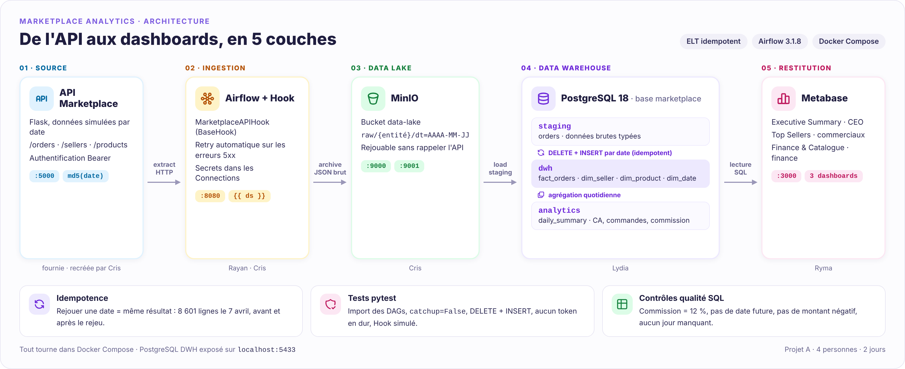
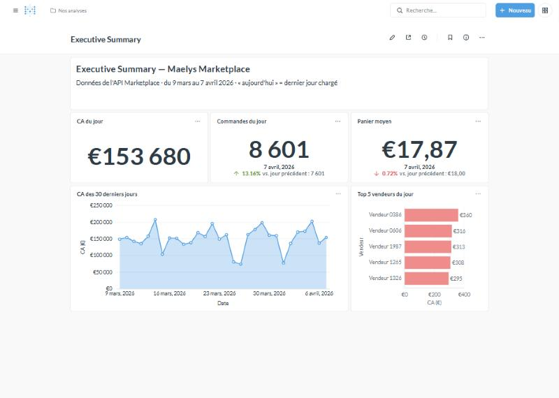
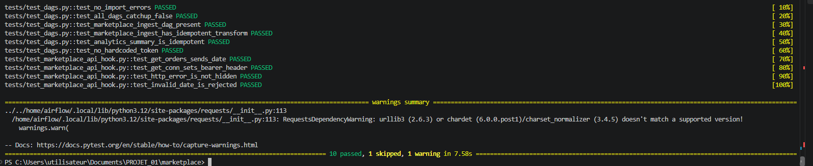

# MarketPlace Analytics

MVP de plateforme data pour **Maelys Marketplace** (marketplace e-commerce, 12 % de commission par vente).
Le pipeline récupère les ventes depuis l'API du backoffice, les archive dans un data lake, les range dans un Data Warehouse et les affiche dans des dashboards, sans plus aucune extraction manuelle.

## Équipe

| Personne | Rôle | Branche |
|---|---|---|
| Rayan | Infrastructure et Airflow | `feature/infrastructure-airflow` |
| Cris | API, MinIO et ingestion | `feature/api-minio` |
| Lydia | PostgreSQL et Data Warehouse | `feature/data-warehouse` |
| Ryma | Metabase, dashboards et tests | `feature/metabase-tests` |

## Architecture

```mermaid
flowchart LR
    subgraph SRC["1 · Source"]
        API["API Marketplace<br/>Flask · auth Bearer"]
    end

    subgraph ORCH["2 · Orchestration"]
        AF["Apache Airflow 3.1.8<br/>MarketplaceAPIHook"]
    end

    subgraph LAKE["3 · Data Lake"]
        MINIO[("MinIO<br/>raw/entité/dt=AAAA-MM-JJ")]
    end

    subgraph DW["4 · Data Warehouse · PostgreSQL 18"]
        direction TB
        STG["staging<br/>données brutes typées"]
        DWH["dwh<br/>schéma en étoile"]
        ANA["analytics<br/>agrégats quotidiens"]
        STG -->|"DELETE + INSERT<br/>par date"| DWH --> ANA
    end

    subgraph BI["5 · Restitution"]
        MB["Metabase<br/>3 dashboards"]
    end

    API -->|"extract"| AF
    AF -->|"archive JSON"| MINIO
    MINIO -->|"load"| STG
    ANA --> MB
    DWH --> MB

    classDef src fill:#E0F2FE,stroke:#0369A1,color:#0C4A6E
    classDef orch fill:#FEF3C7,stroke:#B45309,color:#78350F
    classDef lake fill:#DCFCE7,stroke:#15803D,color:#14532D
    classDef dw fill:#EDE9FE,stroke:#6D28D9,color:#3B0764
    classDef bi fill:#FCE7F3,stroke:#BE185D,color:#831843
    class API src
    class AF orch
    class MINIO lake
    class STG,DWH,ANA dw
    class MB bi
```



<details>
<summary>Version Mermaid du schéma</summary>



</details>

| Service | Port | Rôle |
|---|---|---|
| Airflow 3.1.8 | 8080 | Orchestration |
| PostgreSQL 18 (`postgres-dwh`) | 5433 | Data Warehouse, base `marketplace` |
| MinIO | 9000 / 9001 | Data lake, bucket `data-lake` |
| API Marketplace | 5000 | API simulée (données déterministes par date) |
| Metabase | 3000 | Dashboards |

## Structure du projet

Les éléments marqués ✨ sont ajoutés par la branche `feature/metabase-tests` (Ryma) ; le reste vient de `main`.

```
marketplace/
├── api/                                  # API Marketplace simulée (Cris)
│   ├── Dockerfile
│   ├── app.py                            #   /health, /orders, /sellers, /products, /customers
│   └── requirements.txt
├── config/
│   └── airflow.cfg                       # Configuration Airflow (Rayan)
├── dags/
│   └── marketplace_orders_ingest_daily.py  # DAG principal (Rayan)
├── docs/
│   ├── ingestion.md                      # Documentation de l'ingestion (Cris)
│   └── img/                              ✨ Schéma d'architecture et captures des dashboards
│       ├── architecture.png
│       ├── dashboard1_executive_summary.jpg
│       ├── dashboard2_top_sellers.jpg
│       └── dashboard3_finance_catalogue.jpg
├── init-db/
│   └── schema.sql                        # Schémas staging / dwh / analytics et tables (Lydia)
├── metabase/                             ✨ Dashboards Metabase (Ryma)
│   ├── metabase-sql/                     #   requêtes SQL de chaque graphique
│   │   ├── dashboard1_executive_summary.sql
│   │   ├── dashboard2_top_sellers.sql
│   │   ├── dashboard3_analyses_qualite.sql   # analyses + contrôles qualité
│   │   └── bonus_commissions_categories.sql
│   └── dev/
│       └── seed_demo_data.sql            #   données de démo (usage local uniquement)
├── plugins/marketplace/                  # Code d'ingestion (Cris)
│   ├── __init__.py
│   ├── api_hook.py                       #   MarketplaceAPIHook (BaseHook, Bearer, retry)
│   ├── ingestion.py                      #   archive MinIO + chargement PostgreSQL
│   └── run_ingestion.py                  #   ingestion complète d'une date
├── scripts/
│   └── charger_periode.ps1               # Charge plusieurs jours d'un coup (Lydia)
├── sql/                                  # Transformations idempotentes (Lydia)
│   ├── analytics_daily_summary.sql       #   dwh → analytics
│   ├── transform_fact_orders.sql         #   staging → dwh (DELETE + INSERT)
│   └── tests/
│       └── test_idempotence_local.sql    #   test d'idempotence avec de fausses données
├── tests/                                # Tests pytest
│   ├── conftest.py                       ✨ Chargement des DAGs pour les tests (Ryma)
│   ├── test_dags.py                      ✨ Import, catchup, idempotence, token (Ryma)
│   ├── test_marketplace_hook.py          ✨ Ancien test du Hook (ignoré, voir « Limites »)
│   └── test_marketplace_api_hook.py      # Tests du Hook avec fausses réponses HTTP (Cris)
├── .env.example                          # Modèle des variables d'environnement
├── .gitignore
├── README.md                             ✨ Ce fichier
├── docker-compose.yaml                   # Stack Airflow (Rayan)
└── docker-compose.override.yaml          # PostgreSQL DWH, MinIO, API, Metabase
```

## Lancement

```powershell
git clone https://github.com/rayenouanes/marketplace.git
cd marketplace
copy .env.example .env          # puis remplacer les CHANGE_ME
docker compose up -d            # les tables sont créées automatiquement (init-db)
```

Charger des données (ingestion + transformations, jour par jour) :

```powershell
powershell -ExecutionPolicy Bypass -File .\scripts\charger_periode.ps1 -Debut 2026-03-09 -Fin 2026-04-07
```

## Modèle de données

- `staging.orders` : données brutes typées
- `dwh` : `fact_orders` (une ligne = un produit vendu) + `dim_seller`, `dim_product`, `dim_date`
- `analytics.daily_summary` : une ligne par jour (commandes, CA, commission, panier moyen)

**Idempotence :** chaque transformation fait `DELETE` puis `INSERT` sur la date du jour, dans une transaction. Rejouer le 7 avril donne toujours **8 601 lignes**, sans doublon.

## Dashboards Metabase

**Accès :** http://localhost:3000

| Compte admin Metabase | |
|---|---|
| Email | `admin@maelys.local` |
| Mot de passe | `Admin2026!` |

> Identifiants de formation (cahier des charges §10.2), à remplacer en production.

**Connexion à la base** (Administration → Bases de données) : hôte `postgres-dwh`, port `5432`, base et utilisateur `marketplace`, mot de passe `DWH_PASSWORD` du `.env`.

| Dashboard | Pour qui | Contenu |
|---|---|---|
| Executive Summary | CEO | CA, commandes et panier du jour · CA sur 30 jours · Top 5 vendeurs |
| Top Sellers | CEO, commerciaux | Top 10 du mois · évolution du top 3 · vendeurs inactifs |
| Finance & Catalogue | Finance, catalogue | Commissions par jour (12 %) · top commissions · catégories |



Requêtes versionnées dans `metabase/metabase-sql/`. « Aujourd'hui » = dernier jour chargé (`MAX(dt)`), car les données datent d'avril 2026.

## Tests

```powershell
docker compose exec airflow-worker pytest tests/ -v
```

**Résultat : 10 tests réussis** (1 ancien test ignoré).



Imports des DAGs sans erreur · `catchup=False` · transformation idempotente · aucun token en dur · Hook testé avec de fausses réponses HTTP.
Des contrôles qualité SQL (commission ≠ 12 %, dates futures, jours manquants…) sont dans `metabase/metabase-sql/dashboard3_analyses_qualite.sql`.

## Choix techniques

- **ELT en SQL sur PostgreSQL** : suffisant pour ≈ 8 500 commandes par jour, pas besoin de Spark.
- **MinIO** : garder le JSON brut permet de rejouer sans rappeler l'API.
- **Schéma en étoile** : simple à lire et à interroger depuis Metabase.
- **Connections Airflow** : aucun mot de passe ni token dans le code.

## Limites et suite

- Le DAG `marketplace_orders_ingest_daily` est encore un squelette : le pipeline tourne via `charger_periode.ps1`. Prochaine étape : câbler les tâches dans le DAG.
- `tests/test_marketplace_hook.py` vise un ancien chemin de module et est ignoré par pytest : les vrais tests du Hook sont dans `test_marketplace_api_hook.py`.
- Bonus non réalisés : DataQualityOperator, DAG d'anomalies, Prometheus / Grafana.
- Avec plus de temps : dbt et une CI qui lance pytest à chaque Pull Request.
